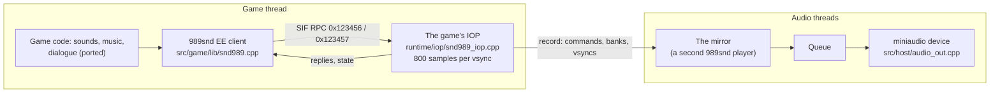

# Audio

The game's sound runs through Sony's 989snd sound system: a client library on the EE that sends
commands, and a driver on the IOP, the PS2's I/O processor, that mixes the voices. The port keeps the
game's client code (ported), runs the IOP side with OpenGOAL's reimplementation of the 989snd driver,
and plays the result with miniaudio.

## The EE side

The game never touches sound hardware. Its code calls the 989snd client (`src/game/lib/snd989.cpp`):
`snd_play_sound` (0x12e308), `snd_stop_sound` (0x12e368), `snd_set_sound` (0x12e4c0),
`snd_set_master_volume` (0x12e208), `snd_stream_play` (0x12ec08) and others. These append commands to
one of two 4 KB command buffers at 0x15eca0, sent in batches (`snd_batch_send`, 0x12e9d8) through the
SIF, the EE-to-IOP remote procedure call mechanism. `snd_init` (0x12da28) binds the two servers: the
command server 0x123456 and the bank loader 0x123457.

The game's music and dialogue logic is ported too: `src/game/ovl/music_streams.cpp` changes music
tracks with fades (`music_streams_frame`, 0x265aa8), starts music (`music_start`) and plays dialogue
lines (`dialog_play`).

## The IOP side

`runtime/sif/sif_rpc.cpp` runs the SIF calls synchronously against servers written on the host side.
`runtime/iop/snd989_iop.cpp` registers the two sound servers and runs them on **OpenGOAL's 989snd**
(`third_party/989snd`, from the [jak-project](https://github.com/open-goal/jak-project), ISC licence,
adapted as listed in its README). It loads the level's sound banks into IOP memory, plays, stops and
changes sounds, and answers the game's queries ("is this sound still playing?"). As in the PS2's
driver, a sound id the bank does not have plays nothing (the game asks for some: on Quartu the
hero's low-air beep is sound -1); the first time an id is refused it is reported on the console.
`runtime/iop/snd989_stream.cpp` plays the streamed music and dialogue, read from the disc.

**Reverb.** Each level's light zones carry a reverb setting: when the hero enters one, the game's sound
frame (`sound_frame`, 0x28cc08) sends command 0x50 (`snd_SetReverbEx`: core, type, depth, delay, feedback)
or 0x10 (`snd_AutoReverb`: core, depth, time, channels), and 0x50 with type 0 to turn it off (Veldin).
The synth runs the SPU2's reverb (the effect area's same-side / different-side reflections, four combs and
two all-pass filters, at 24 kHz) with the SDK's presets (room, studio A / B / C, hall, space, echo, delay,
pipe); its output, scaled by the depth (the SPU2's effect volume), is added to the mix. The voices that feed
it are those whose tone has the reverb flag (0x1), or plays only into the reverb (0x10).

**Pan and pitch.** Command 0x21 (`snd_SetSoundParams`, 0xb428) with flag 4 moves a sound's pan with
`snd_AutoPan` (over handler ticks, the shortest way) instead of jumping, as the IRX does for the world's
positional sounds; flag 2 alone sets it at once. Commands 0x0d (`snd_SetMixerMode`), 0x4e
(`snd_SetGroupVoiceRange`) and 0x51 (`snd_SetPanMode`) are accepted and do nothing (the host has no SPU2
cores or voice numbers). The voices' fixed volume changes are ramped over 400 samples (8.3 ms) on the host, so the per-frame
updates do not click; pitch changes apply at once, as on the SPU2 (a ramp made sounds end a frame early,
which the game polls).

**The mix.** The voices are summed in 32 bits and the result clamped to 16 bits once, then the master
volume applied: the SPU2's own output is 16-bit, and sums past full scale clip there too.

**Timing.** Everything the game reads back from the sound must depend only on the game's own time,
not the PC's speed. So the IOP's driver advances exactly 800 samples (1/60 s at 48 kHz) each time a
vsync passes in the game (`vsync_passed` in `src/host/orig_main.cpp`), on the game's thread. The
game's state is then the same however fast or slow the host runs.

## The mirror: sound that keeps playing during loads

On a PS2 the IOP is a separate processor: when the EE is busy for a long frame (reloading a
checkpoint, starting a level, opening a movie), the music keeps playing. In the port the game's IOP
only advances when the game does, so a long stall on the game's thread would leave the audio device
with nothing to play.

The port therefore runs **two copies** of the driver
([Decisions](decisions.md#13-the-iops-sound-runs-twice), still a proposal, on by default):

- **The game's IOP** answers the game's calls and holds the state the game reads. Its output is not
  played.
- **The mirror** is a second 989snd player on the host's audio thread (`iop_loop` in
  `src/host/audio_out.cpp`). The game's IOP records every command with its reply, every bank loaded
  and every vsync; the mirror replays them in order, and what it renders is what you hear. While the
  game keeps up, the mirror produces the same samples as the game's IOP (`RAC1_IOP_VERIFY=1` compares
  them every vsync).
- When the game's thread stalls and the queue is running low, the mirror renders **alone**
  (`snd989_mirror_alone`), so the music and the sounds already playing go on. When the game resumes,
  the mirror is ahead by the stall's length, as a PS2's IOP would be after a long EE frame, and the
  host does not run those game frames again. A stall is the game's thread stuck inside one game frame
  for more than 20 ms after its last vsync (a load), or no vsync for longer than the host's usual gap
  between its frames (a long draw). A host that simply runs below 60 frames a second (the 30 FPS cap,
  VSync at 75 Hz, a heavy scene) is not stalled: it runs two or more game frames per host frame and the
  queue absorbs the gaps (its latency is not lowered below the longest recent gap). Before, any gap
  over 20 ms counted as a stall, and the game ran slower than real time at those rates (issues #4, #8,
  #22).

`RAC1_IOP_MIRROR=0` turns the mirror off and plays the game's IOP directly.

**The audio device** (`audio_out_start`): miniaudio, 16-bit stereo at 48 kHz, three periods of 10 ms
by default (`RAC1_AUDIO_PERIOD_MS`, `RAC1_AUDIO_PERIODS`, `RAC1_AUDIO_DEVICE` to choose another).
The queue between the threads absorbs small differences in pace with a slight rate adjustment, and
ramps the sound in and out over 2.5 ms when it has to skip or runs dry. The device's thread and the
IOP thread ask the system for real-time priority through rtkit (`src/host/host_priority.cpp`;
`RAC1_PRIORITY=0` to not ask). `RAC1_NO_AUDIO` runs without sound.

## Movies

The game's movies are PSS files: an MPEG-2 video stream with SPU2 ADPCM audio tracks, one per
language (English, French, German, Spanish, Italian). The game's movie player is replaced by host
code (`src/game/lib/movie_player.cpp`), which hands the file to the decoder in
`runtime/ipu/movie_hw.cpp`:

- it demuxes the PSS itself and decodes the ADPCM audio track of the game's language (falling back to
  the first track present), resampled to 48 kHz and mixed into the sound output;
- the MPEG-2 video is decoded with the system's FFmpeg (`libavcodec`).

FFmpeg is optional at build time (the `RAC1_MOVIES` CMake option, on by default, uses it when
`pkg-config` finds it). Without it, the game runs and skips the movies, taking the game's own "cannot
open movie" path. `RAC1_MOVIE_VOLUME` changes the movies' volume.
